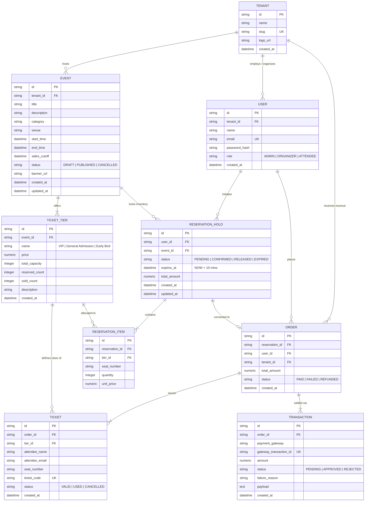

# 🎟️ EventPass — Multi-Tenant Event & Ticket Reservation System

[](https://www.typescriptlang.org/)
[](https://nodejs.org/)
[](https://react.dev/)
[](https://tailwindcss.com/)
[](https://www.postgresql.org/)
[](https://redis.io/)
[](https://opensource.org/licenses/MIT)

A scalable, multi-tenant web application engineered to host high-demand events and sell tiered tickets (VIP, General Admission) with **zero double-booking**. Features ACID atomic transaction locking, a **10-minute temporary reservation hold engine**, **Redis caching layer**, an **automated background queue cleaner**, **mock payment simulation**, and a **real-time organizer analytics dashboard**.

---

## 🌟 Key Features & Functional Requirements

### 1. Role-Based Access Control (RBAC) & Multi-Tenancy
- **Admin**: Global system visibility across all tenant organizers, platform-wide revenue analytics, and infrastructure health monitoring.
- **Organizer**: Scoped strictly to their organization (`tenant_id`). Can create events, configure ticket tiers, set quotas, define sales cut-off deadlines, and track real-time conversion rates.
- **Attendee**: Explores event catalog, reserves tickets into a 10-minute temporary hold, simulates payment checkout, and receives digital passes with QR codes.

### 2. High-Concurrency Reservation Engine & Anti-Double-Booking
- **Zero Race Conditions**: Utilizes atomic transaction locking (`BEGIN IMMEDIATE` in SQLite / `SELECT ... FOR UPDATE` in PostgreSQL) to ensure multiple concurrent booking attempts for the same seats never overbook.
- **10-Minute Temporary Hold**: When an attendee selects tickets, seats are placed on a 10-minute exclusive hold. A real-time synchronized countdown timer is displayed to the user.
- **Automated Expiration Cleaner Worker**: A background worker (running every 15 seconds) detects unconfirmed holds older than 10 minutes, automatically releasing them and restoring ticket capacity back to the available pool.

### 3. Caching Layer (Redis + In-Memory Fallback)
- Caches active event listings (`events:list:*`) and event details (`event:{id}`) to handle heavy read traffic.
- Automatic cache invalidation upon hold placement, order completion, event updates, and hold expirations.
- Gracefully falls back to high-speed in-memory TTL caching if Redis is offline.

### 4. Payment Simulation Gateway
- Simulated asynchronous payment gateway endpoint (`/api/v1/payments/checkout`) allowing instant approval (`200 OK`), card decline simulation (`402 Decline: Insufficient Funds`), or realistic random outcomes.
- On approval: confirms reservation, allocates tickets, and records transactions.
- On decline: automatically releases held seats back to the public pool.

### 5. Real-Time Organizer Analytics Dashboard
- Live revenue calculations and transaction stream.
- **Ticket Conversion Rate Metric**:
  $$\text{Conversion Rate} = \left(\frac{\text{Confirmed Orders}}{\text{Total Holds Initiated}}\right) \times 100\%$$
- Visual breakdown of ticket tier occupancy (VIP vs General Admission) and active live holds.

---

## 📊 Entity Relationship Diagram (ERD)



---

## ⚡ Quickstart Guide

### 1. Prerequisites
- **Node.js** v20+ or v22+ installed
- **Git** installed

### 2. Installation & Setup
```bash
# Clone the repository
git clone https://github.com/sprathishanarayanan-boop/event-ticket-reservation-system.git
cd event-ticket-reservation-system

# Install dependencies
npm install

# Seed the database with sample events, tenants, and test accounts
npm run seed
```

### 3. Run Locally (Full-Stack Dev Mode)
```bash
# Starts Express API (Port 3000) and Vite Client (Port 5173) with hot reload
npm run dev
```
Open **`http://localhost:5173`** in your browser.

Or run production mode:
```bash
npm run build
npm start
```
Open **`http://localhost:3000`**.

---

## 🔑 Pre-Configured Test Accounts

The UI includes a **1-Click Fast Role Switcher** dropdown in the top navigation bar, or you can log in manually:

| Role | Email | Password | Tenant / Scope |
| :--- | :--- | :--- | :--- |
| **ATTENDEE** | `attendee@example.com` | `attendee123` | Individual Ticket Buyer |
| **ORGANIZER** | `organizer@apextech.com` | `organizer123` | Apex Tech Global |
| **ORGANIZER** | `organizer@soundfest.com` | `organizer123` | Neon Horizon Festivals |
| **ADMIN** | `admin@eventpass.com` | `admin123` | Global Platform Admin |

---

## 🧪 Automated Concurrency Stress Test

To verify atomic concurrency locking and double-booking prevention:

```bash
npm run test:concurrency
```

### What this test verifies:
1. Creates an event tier with **strictly 5 available seats**.
2. Fires **30 concurrent asynchronous reservation requests** simultaneously at the exact same millisecond.
3. Asserts:
   - ✅ **Exactly 5 requests succeed** with HTTP 201 Created and hold assigned.
   - 🛡️ **Exactly 25 requests fail** with HTTP 409 Conflict (`Seats exhausted`).
   - 📦 Final database reserved count is exactly `5 / 5` (**Zero Overbooking**).
4. Tests the 10-minute hold cleaner worker by artificially aging holds, running the worker, and confirming capacity returns to 0.

---

## 📮 Postman Collection & Edge Cases

The project includes an evaluation-ready Postman collection located in `/postman`:
- `postman/Multi_Tenant_Event_Reservation_System.postman_collection.json`
- `postman/Multi_Tenant_Environment.postman_environment.json`

### Key Scenarios Covered:
1. **Authentication & RBAC**: Token generation and access enforcement for Admin, Organizer, and Attendee.
2. **Redis Read Caching**: Verifies cached response headers on `/events` and `/events/:id`.
3. **10-Minute Hold Engine**: Tests hold placement, remaining duration countdown, and voluntary cancellation.
4. **Edge Case: Overbooking (HTTP 409 Conflict)**: Submitting a reservation request for more tickets than remaining inventory.
5. **Edge Case: Expired Session Checkout (HTTP 410 Gone)**: Attempting to pay for a hold whose 10-minute window has elapsed.
6. **Payment Simulation**:
   - `simulate_outcome: "APPROVED"` $\to$ Issues valid QR tickets.
   - `simulate_outcome: "REJECTED"` $\to$ Simulates card decline and releases seats back to inventory.
7. **Real-time Analytics**: Asserts total revenue, conversion rates, and tier occupancy metrics.

---

## 🐳 Docker & Production Deployment

### Option 1: Docker Compose (App + PostgreSQL + Redis)
```bash
docker-compose up --build
```
Spins up:
- Express Fullstack App on `http://localhost:3000`
- PostgreSQL 16 on `5432`
- Redis 7 on `6379`

### Option 2: One-Click Cloud Deployment (Render / Railway / Vercel)
The repository includes pre-configured deployment blueprints:
- **Render**: `render.yaml` — automatically connects database, runs migrations, seeds, and serves on Render Free Tier.
- **Vercel**: `vercel.json` — deploys the Vite SPA and serverless API endpoints.
- **Railway**: Deploys via `Dockerfile` with one-click PostgreSQL and Redis add-ons.

---

## 📤 Push to GitHub Guide

To push your repository to your remote:

```bash
cd C:\Users\sprat\.gemini\antigravity\scratch\event-ticket-reservation-system

# Stage all files
git add .

# Create initial commit
git commit -m "feat: complete multi-tenant event & ticket reservation system with atomic concurrency, 10-min holds, and analytics"

# Ensure default branch is main
git branch -M main

# Push to your GitHub repository
git push -u origin main
```

---

## 📜 License
This project is open-source and licensed under the [MIT License](LICENSE).
