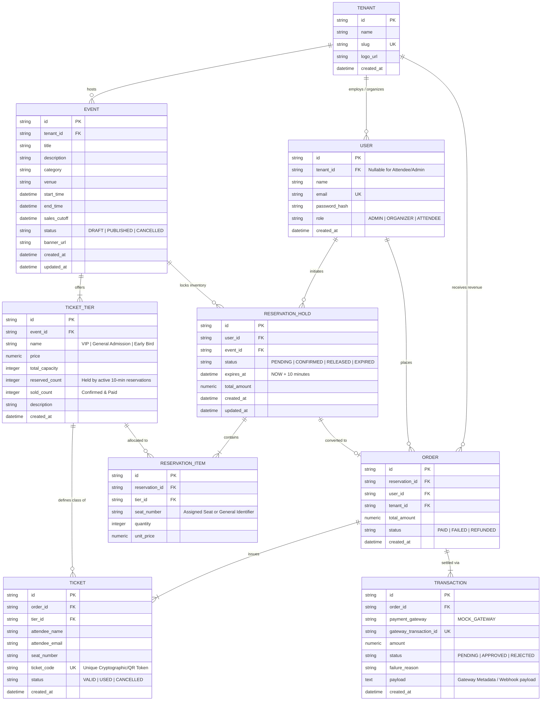

# Multi-Tenant Event & Ticket Reservation System — Entity Relationship Diagram (ERD)

## 1. High-Level Entity-Relationship Model

---

## 2. Table Specifications & Cardinalities

### 1. `tenants`
- **Purpose**: Defines isolated organizer organizations in the multi-tenant architecture.
- **Cardinality**: `1 Tenant : Many Events`, `1 Tenant : Many Organizers`.

### 2. `users`
- **Purpose**: Role-Based Access Control (RBAC).
- **Roles**:
  - `ADMIN`: Global administration across all tenants.
  - `ORGANIZER`: Scoped strictly to their `tenant_id`. Manages events, ticket tiers, and views real-time conversion & revenue analytics.
  - `ATTENDEE`: End-user purchasing tickets, holding temporary seats, and viewing digital passes.

### 3. `events`
- **Purpose**: Event listings hosted by an organizer tenant.
- **Key Attributes**: `sales_cutoff` enforces hard stops on purchases; `status` controls booking availability.

### 4. `ticket_tiers`
- **Purpose**: Tiered inventory breakdown (VIP, General Admission).
- **Invariant**:
  $$\text{Available Seats} = \text{total\_capacity} - (\text{reserved\_count} + \text{sold\_count})$$
  Atomic locking guarantees $\text{Available Seats} \ge 0$ at all times.

### 5. `reservation_holds`
- **Purpose**: 10-minute temporary seat reservation engine.
- **Lifecycle**:
  - `PENDING`: Seats currently locked exclusively for attendee. Expiration countdown active ($10\text{ min}$).
  - `CONFIRMED`: Successfully checked out and paid. `reserved_count` decremented; `sold_count` incremented.
  - `EXPIRED`: 10-minute timer passed without payment. Inventory automatically reclaimed by background worker.
  - `RELEASED`: Manually cancelled by attendee or rejected by gateway decline.

### 6. `orders` & `tickets`
- **Purpose**: Permanent financial order record and unique attendee passes with QR verification tokens.

### 7. `transactions`
- **Purpose**: Payment gateway audit log tracking simulated card authorizations, declines, and gateway IDs.
